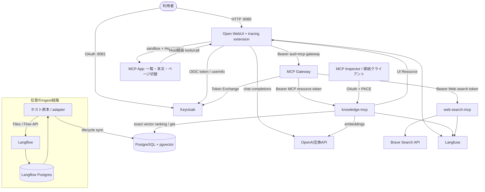

# アーキテクチャ

## コンポーネント

| コンポーネント | 役割 |
|---|---|
| Open WebUI v0.13.0派生イメージ | Keycloak SSO、会話、native tool calling、MCP Apps Host、永続会話データ |
| `src/open_webui_ext/` | Registryから接続設定・グループ・初回既定モデルのread grantを作成。会話・LLM・MCP・App操作の限定した観測hook |
| MCP Gateway（`gateway/`） | Chat UIのJWT検証、role / Tool / Resource認可、Keycloak Token Exchange、メタデータを保持する中継 |
| knowledge-mcp（`src/knowledge_mcp/`） | FastMCP 3、ベクトル検索とチャンク本文取得、認証付きApps HTML Resource |
| web-search-mcp（`src/web_search_mcp/`） | FastMCP 3、Brave Web検索 |
| PostgreSQL 17 + pgvector | アプリの検索対象`documents`。1行は1チャンク |
| Keycloak | ローカルIdP、接続先role、Token Exchange、直結MCPの認可サーバー |
| Langfuse | 会話からLLM・MCP・embedding・DBまでのトレース取り込みと表示 |
| Langflow（任意） | 専用CollectionへのIngest。ホストadapterがアプリの`documents`へ複製 |

Open WebUIは標準のHost・sandbox・認証処理を使う。専用拡張はHostを再実装せず、固定された上流ソースへの観測hookだけを追加する（[ADR-0015](/decisions/ADR-0015-open-webui-mcp-apps.md)）。

## 接続構成



GatewayはDocker内部のみ公開する。ブラウザのAppはGatewayやMCPへ直接接続せず、Open WebUIのHost bridgeを使う。アクセストークンと交換後トークンをiframeへ渡さない。

## MCPと検索

輸送は既存のStreamable HTTP。Gatewayはcore `2025-11-25`のhandshake互換経路、Appsはstable `2026-01-26`を対象にする。最新coreへの全面移行はこの構成に含めない。

FastMCP側のMCP SDK 1.30とGatewayの公式SDK 2.3は別のlock・実行環境に置く。これは各adapterが検証したSDK契約を固定するためで、退役したChainlitへの依存ではない。両Python imageはlockをコピーし、`uv sync --frozen --no-dev --no-editable`で構築する。

```text
Streamable HTTP / JWT
  → MCP Tool・Resourceの認可
    → SearchService
      → EmbeddingClient（OpenAI互換API）
      → VectorRepository（asyncpg + pgvector）
```

検索はcosine距離とチャンクUUIDで順位を安定させ、`offset`と`top_k`でページを取得する。HNSWの探索上限による深いページの欠落を避けるため、現行の取得経路はexact距離計算を使う。最大20件は1ページの上限であり、検索結果全体の上限ではない。詳細は[検索バックエンド](/current/features/backend.md)と[API](/current/features/api.md)。

## 認証と設定

Open WebUIの専用clientは`open-webui`。SSO tokenを`system_oauth`でGatewayへ送り、Gatewayは接続先向けにToken Exchangeする。Keycloak roleはOpen WebUIのグループにも同期し、接続先の表示と実行権限を揃える。GatewayとMCPでも毎回認可する（[認証認可](/current/features/authentication.md)）。

Registryが接続先の正本。起動時にOpen WebUI設定へ反映し、利用者による任意URL追加は提供しない。会話とOAuth状態は`open_webui_data`に永続化する。旧Chainlit clientや`chainlit_oauth_tokens`は互換・復旧用のデータとして残し、実行経路には使わない。

## 観測とIngest

通常のチャットは`chat.turn`を1ターン1本のルートにし、`llm.generate`、Tool、MCP、embedding、DBを同じtraceへ接続する。後続のApp操作は`mcp.app`を別のルートにする。属性と秘匿ルールの正本は[トレーシング](/current/features/tracing.md)。

Langflowは任意のIngest sidecarで、検索の実行先ではない。SearchServiceはLangChain / Langflow Collectionを読まない。原本から`documents`への反映は[Ingest](/current/features/ingest.md)、起動・移行・検証は[インフラ](/current/infrastructure.md)を参照。
