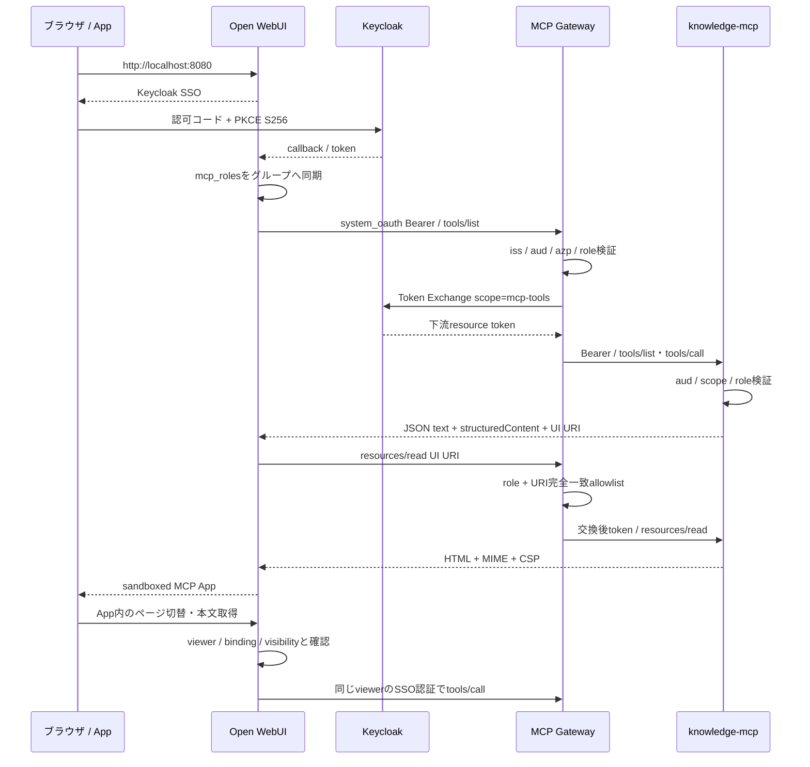

# Open WebUI・Gateway・MCPの認証認可

## 設定の正本

- realm / client / scope / 開発ユーザー: `infra/app/keycloak/knowledge-realm.json`。
- Gatewayの接続先、下流resource、scope、allowed Tool / Resource、required role: `infra/app/gateway-registry.yml`。
- Open WebUIのMCP接続とグループ: `src/open_webui_ext/startup.py`がRegistryから生成する。
- 既存realmへの追加・更新: `scripts/sync_keycloak_openwebui.py`。Open WebUI専用clientとscope、mapper、scope紐付けだけを同期する。

[ADR-0015](/decisions/ADR-0015-open-webui-mcp-apps.md)が現行UIの判断。GatewayのToken Exchange境界は[ADR-0012](/decisions/ADR-0012-mcp-gateway-resource-server.md)、サーバー単位の輸送は[ADR-0013](/decisions/ADR-0013-mcp-gateway-per-server-streamable-http.md)を維持する。

## 利用者と接続先

| 開発ユーザー | knowledge | Web検索 |
|---|---|---|
| `dev` / `dev` | 許可 | 許可 |
| `dev2` / `dev2` | 拒否 | 許可 |
| `readerless` / `readerless` | 拒否 | 拒否 |

Keycloakの`knowledge-mcp-reader`と`web-search-reader`を、Open WebUIの同名・固定IDグループに対応付ける。`mcp_roles` claimはID token / userinfoにも載せ、ログイン時にメンバーシップを同期する。接続設定の`access_grants`は各グループへのread権限。`BYPASS_ADMIN_ACCESS_CONTROL=false`により、UI管理者も明示grantを迂回しない。

UIの表示制御だけに認可を委ねない。GatewayはJWTの`realm_access.roles`とRegistryを照合し、下流MCPもroleとscopeを検証する。

## トークンの境界

| 経路 | 主なclaim |
|---|---|
| Open WebUI → Gateway | `iss=http://localhost:8081/realms/knowledge`、`aud=mcp-gateway`、`azp=open-webui`、`sub`、realm roles |
| Gateway → knowledge-mcp | `aud=http://localhost:8000/mcp`、scope `mcp-tools`、role `knowledge-mcp-reader` |
| Gateway → web-search-mcp | `aud=http://localhost:8001/mcp`、scope `web-search-mcp-tools`、role `web-search-reader` |

Gatewayは受信tokenを下流へパススルーしない。接続先ごとにToken Exchangeし、交換後JWTのaudienceも再検証する。App iframeへいずれのtokenも渡さない。

## ログインからTool・Appまで

Open WebUIの`system_oauth`は各HTTPリクエストで現在の利用者のSSO access tokenを解決する。App RPCもログイン中viewerの認証、server / tool binding、接続先へのアクセス権、App-visible Toolを再検査する。過去のAppを別ユーザーで開いても元の利用者のtokenを流用しない。

Gatewayは`tools/list`・`tools/call`・`resources/list`・`resources/read`のroleをToken Exchange前に検証する。knowledgeのResource allowlistは`ui://knowledge/search-results.html`のみ。未登録URIは404、role不足は403。Web検索のResource一覧は空で、Resource readを許可しない。詳細なAPIは[契約](/current/features/api.md)を参照。

## OIDCとセッション

- clientはconfidential `open-webui`。callbackは`http://localhost:8080/oauth/oidc/callback`、PKCEはS256。
- Open WebUIは内部URL`http://keycloak:8080/realms/knowledge/.well-known/openid-configuration`を読む。Keycloakのfrontend hostnameは`http://localhost:8081`、dynamic backchannelを有効にし、ブラウザ向けURLとコンテナのtoken / userinfo / JWKSを分ける。
- Keycloak access tokenは300秒、SSO idleは8時間、maxは10時間。Open WebUIのJWT期限は10時間。`offline_access`は要求しない。
- Open WebUIがSSO tokenの更新を管理する。利用者の認証が失効した場合は再ログインする。Gatewayへの401再試行で期限切れtokenを匿名接続へ置き換えない。
- 会話・OAuth状態は`open_webui_data`へ保存し、固定`WEBUI_SECRET_KEY`を維持する。旧Chainlit Cookieは新UIの認証に使わない。

Open WebUI v0.13.0の標準SSO処理は、refreshが失敗すると保存済みOAuthセッションを破棄する。失効したrefresh tokenの拒否に加え、一時的な5xxや通信失敗もこの扱いになる。cookieに対応するセッションが使えない場合は、同じ利用者の別の保存済みSSOセッションを探す。有効なセッションを取得できなければ、MCPを再利用するにはKeycloakでSSOログインをやり直す。Open WebUIのユーザーと保存済み会話は維持される（[固定版のOAuth実装](https://github.com/open-webui/open-webui/blob/v0.13.0/backend/open_webui/utils/oauth.py)）。

## 既存realmからの移行

初回importだけでは既存realmに新clientは追加されない。Composeの`keycloak-sync`がKeycloak ready後に専用client / scopeを冪等同期し、完了後にOpen WebUIを起動する。手動同期は`make -C infra sync-auth`。

この処理はrealmを削除・再importせず、既存ユーザー、Gateway / MCP client、旧Chainlit client、roleを残す。旧`chainlit_oauth_tokens`も削除しない。Keycloakコンテナ自体のライフサイクルと保存領域は[インフラ](/current/infrastructure.md)を参照。

## 直結クライアント

Gatewayを通らないMCP Inspector等は、MCPのProtected Resource MetadataからKeycloakを発見し、匿名DCRと認可コード + PKCEで直接resource tokenを取得する（[ADR-0014](/decisions/ADR-0014-mcp-direct-three-legged-oauth.md)）。localhost / 127.0.0.1のローカルredirectに限定する。下流MCPは`azp=open-webui`には限定せず、audience・scope・roleを検証する。

非対話検証用Bearerは`uv run python scripts/mcp_dev_token.py --target knowledge`。Web検索は`--target web-search --username dev2`。出力tokenをログやトレースへ保存しない。
