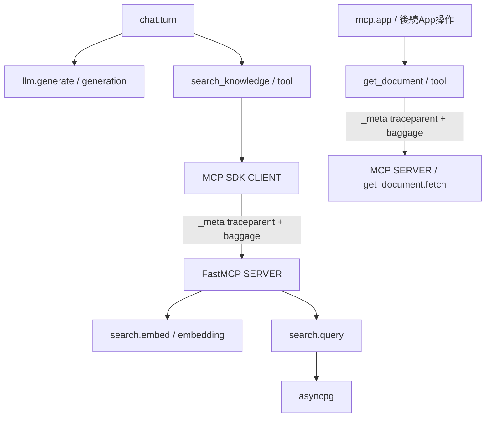

# Langfuse OTELトレーシング

## 観測単位

通常のチャットは1ターンにつき`chat.turn`を1本のルートにし、LLM、Tool、MCP、embedding、DBを同じtrace内へ接続する。ユーザーが後から行うApp内のページ取得・本文取得は、独立した`mcp.app`ルートにする。HostのApp callbackにはchat / message IDがないため、過去の`chat.turn`への結合は行わない。

## 実装入口

| コンポーネント | 初期化・観測 |
|---|---|
| Open WebUI | `src/open_webui_ext/tracing.py`。Langfuse 4.15.1。会話・generation・Tool・App RPCを観測 |
| knowledge-mcp | `src/knowledge_mcp/server.py`でFastMCP import前にLangfuseを初期化。`tracing.py`で検索 / embedding / DBを観測 |
| web-search-mcp | `src/web_search_mcp/server.py`で同じ初期化順。`tracing.py`でWeb検索ToolのI/Oを記録 |
| MCP Gateway | Langfuse exportは行わず、受信`_meta`とW3C contextを下流へ中継 |

Langfuseキーが未設定、または`LANGFUSE_TRACING_ENABLED=false`なら観測をno-opにし、検索・会話を継続できる。

## Open WebUIの限定hook

標準Host実装を変更せず、固定v0.13.0の次の4点へ`src/open_webui_ext/patch.py`でhookを追加する。対象ファイルのhashと一意なanchorが一致しなければimage buildを失敗させる。

| 対象 | hookの責務 |
|---|---|
| chat completionのbackground worker | `chat.turn`の開始・終了、user / chat属性とbaggage、入力・最終応答 |
| providerへの`generate_chat_completion` | `llm.generate`、model、token usage、stream終了までのlifecycle |
| `MCPClient.call_tool_raw` | Tool observation、秘匿済み引数・結果、MCP `_meta`へtrace context注入 |
| `mcp_app_rpc` | 独立した`mcp.app`、viewer、接続先、操作method |

Open WebUIのOTel以外の既存依存をconstraintsで固定し、Langfuse 4.15.1を追加する。OTelは`infra/app/open-webui-otel-requirements.txt`でAPI / SDK / exporterを1.45.2、instrumentation系を0.66b2へ固定する。[GHSA-mf5v-w3w3-f6cg](https://github.com/open-telemetry/opentelemetry-python/security/advisories/GHSA-mf5v-w3w3-f6cg)のJSON metadata経由の過大な`traceparent`解析を修正する組み合わせで、他のbase image依存は更新しない。`pip check`をbuild gateにする。`ENABLE_OTEL=false`で上流の汎用OTel exporterと二重初期化しない。streamはLangfuseのcontext保持wrapperを使い、SSEからusageだけを観測する。キャンセル時にもspanを終了し、並行ターンのcontextを分離する。

## 属性とI/O

| 属性 | 値 |
|---|---|
| `user.id` | Open WebUIのOAuth属性に保存されたKeycloak `sub`を優先。存在しない場合は内部user ID |
| `session.id` | 通常の会話はOpen WebUI chat ID。App callbackにはchat IDを付けない |
| trace tags / component | `open-webui`。App操作は`mcp-app`も付ける |
| `service.name` | `open-webui`、`knowledge-mcp`、`web-search-mcp` |
| environment / release | `LANGFUSE_TRACING_ENVIRONMENT` / `LANGFUSE_RELEASE`の設定値 |
| generation model / usage | 実際のmodel、入力・出力・合計token。stream / nonstream両対応 |

Tool observationには`tool.route=gateway`、`tool.server_id`、`tool.mcp_name`を付ける。MCPのJSON textと`structuredContent`は同じ検索データを保持し、トレースへ送るときにsanitizeする。

MCP `_meta`には`traceparent`、存在時の`tracestate`、`baggage`を注入する。Gatewayはネストしたmetadataを保持し、FastMCP側の`extract_langfuse_propagated_context`が親へ接続する。通常のチャットでAppを表示する最初の検索も、元の`chat.turn`内に記録する。

## 秘匿とexport

- APIキー、access / refresh token、Authorization、embeddingの値をspanへ記録しない。
- Open WebUI拡張は`_meta`を出力観測から除き、token / API key / embedding関連フィールドをredactする。長い文字列は500文字でtruncateし、Tool結果のJSON text内もsanitizeする。
- MCP側の`get_document.content`は先頭500文字にtruncateする。UIに渡す本文は、このトレース用truncateとは別に保持する。
- user識別にメールアドレスをtrace metadataへ載せない。
- MCP側Langfuse exporterは`fastmcp`と`opentelemetry.instrumentation.asyncpg`を追加許可し、不要なHTTPクライアントspanを送らない。
- Open WebUIのMCP SDK 2.3.0はCLIENT spanのIDを送信`_meta`へ注入するため、親を持つ`mcp-python-sdk` spanも公開`should_export_span`で出力する。標準フィルターだけでは下流の親IDが欠落する。SDK spanの属性はMCP methodとJSON-RPC request IDで、引数・結果・HTMLは含まない。独立したinitialize spanは出力しない。

## 設定と検証

`LANGFUSE_PUBLIC_KEY`、`LANGFUSE_SECRET_KEY`、`LANGFUSE_HOST`、必要時のenvironment / releaseをルート`.env`へ設定する。Compose内の送信先は`http://langfuse-web:3000`。キーはResource・Tool schema・ログに含めない。

自動検証は`tests/test_openwebui_ext.py`、`tests/test_openwebui_ext_patch.py`と既存の`test_trace_propagation.py`、`test_langfuse_span_export.py`、`test_tracing_metadata.py`、`test_tool_trace_output.py`。並行ユーザーの分離、stream / cancellation、model / usage、sanitize、Appとチャットの観測単位を対象にする。

実環境では、1ターン1ルート、ToolとMCPの親子関係、embedding / DB、user / chat識別、後続App操作の独立ルートを確認する。手順は[インフラ](/current/infrastructure.md)。一般のMCP伝播の判断は[ADR-0004](/decisions/ADR-0004-langfuse-mcp-meta-tracing.md)、UI移行は[ADR-0015](/decisions/ADR-0015-open-webui-mcp-apps.md)を参照。
